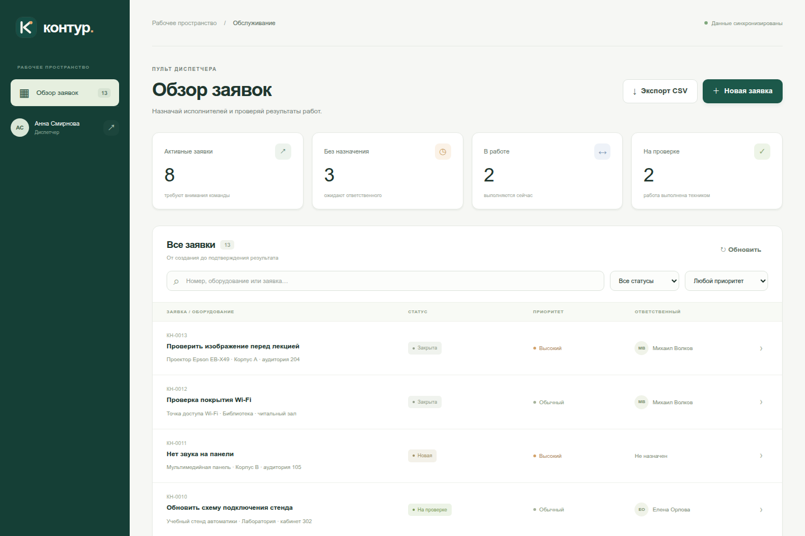

# Контур · обслуживание оборудования

Курсовой проект по дисциплине «Разработка профессиональных приложений».

**Павленко Богдан Евгеньевич · ДЭ 21-25 · 2 курс · 2026**

Тема: **«Разработка клиент-серверного приложения для управления заявками на обслуживание оборудования»**.

Диспетчер регистрирует неисправность на компьютере, техник получает её на телефоне, выполняет работу и фиксирует результат. Диспетчер проверяет результат и закрывает заявку. Оба устройства используют одну серверную базу, а доступные действия определяются ролью.

[Пояснительная записка в PDF](report/main.pdf) · [Версия Word](report/Курсовой_проект.docx) · [Демонстрация на двух устройствах](docs/TWO_DEVICES.md) · [Выступление на защите](report/DEFENSE.md)



## Что реализовано

- Два рабочих места: диспетчер и техник, адаптивный интерфейс для компьютера и телефона.
- Вход по логину и паролю; права проверяются сервером на каждом запросе.
- Регистрация, назначение, приоритеты, поиск и фильтрация заявок.
- Цикл «Новая → Назначена → В работе → Выполнена → Закрыта», возврат результата на доработку.
- Комментарии, журнал действий, обязательный результат выполнения.
- Автоматическое обновление данных примерно каждые 5 секунд при активной странице.
- Контроль версии записи: устаревшее изменение получает HTTP 409, а не перезаписывает чужую работу.
- Выгрузка CSV для диспетчера.
- SQLite с внешними ключами и транзакциями; данные сохраняются после перезапуска.
- Автоматизированные проверки основных правил и отрицательных сценариев.

Это учебное приложение на синтетических данных. Оно не внедрено в университете и не представляет его действующую информационную систему.

## Быстрый запуск

Нужны Python 3.11+ с модулем sqlite3 и современный браузер. Фактически проверенную среду смотри в `docs/VERIFICATION.md`.

Linux / macOS, из папки репозитория:

```bash
python3 -m venv .venv
.venv/bin/python -m pip install -r requirements.txt
.venv/bin/python app.py init-demo
.venv/bin/python app.py serve --host 0.0.0.0 --port 8080
```

Windows PowerShell:

```powershell
py -m venv .venv
.\.venv\Scripts\python.exe -m pip install -r requirements.txt
.\.venv\Scripts\python.exe app.py init-demo
.\.venv\Scripts\python.exe app.py serve --host 0.0.0.0 --port 8080
```

`init-demo` выполняется один раз для пустой базы. Повторный вызов не удаляет существующие данные и завершается с объяснением. Для обычного повторного запуска нужна только последняя команда.

На компьютере открой **http://localhost:8080**. На втором устройстве в той же доверенной Wi-Fi-сети открой **http://IP-КОМПЬЮТЕРА:8080**. Адрес `0.0.0.0` — адрес прослушивания сервера, а не адрес страницы. Инструкции и диагностика: [docs/TWO_DEVICES.md](docs/TWO_DEVICES.md).

| Роль | Логин | Демонстрационный пароль |
|---|---|---|
| Диспетчер | `dispatcher` | `demo-dispatch-2026` |
| Техник Михаил | `tech` | `demo-tech-2026` |
| Техник Елена | `tech2` | `demo-tech2-2026` |

Пароли опубликованы намеренно для **локальной учебной демонстрации**, не для работы с настоящими данными. Входы двух ролей на одном компьютере проверяй в разных профилях браузера или в обычном и приватном окне. Две вкладки одного профиля на одном адресе разделяют сессию.

## Проверки

```bash
.venv/bin/python -m pip install -r requirements-dev.txt
.venv/bin/python -m pytest -q
```

Тесты используют временные базы. Реальное состояние и ограничения проверки зафиксированы в [docs/VERIFICATION.md](docs/VERIFICATION.md). Наличие файла GitHub Actions не означает, что удалённая проверка уже запускалась.

## Устройство проекта

```text
app.py                 HTTP API, бизнес-правила, SQLite, запуск
static/                HTML, CSS, JavaScript и иконка
tests/                серверные проверки
report/                пояснительная записка, схемы, материалы защиты
docs/                 инструкции, ограничения, результаты проверки
.github/workflows/     проверка тестов при публикации на GitHub
```

Сервер — Flask и Waitress; хранение — SQLite; интерфейс — JavaScript без сборщика и внешних CDN. Один процесс сервера обслуживает клиентов, база находится только на сервере. Подробнее: [docs/ARCHITECTURE.md](docs/ARCHITECTURE.md).

## Данные и границы применения

Рабочие данные находятся в `data/`: база `kontur.sqlite`, её служебные файлы и случайный ключ подписи сессий. Каталог исключён из Git. Для другого каталога задай `KONTUR_DATA_DIR` до запуска. Не копируй работающую SQLite-базу обычным копированием одного файла: используй `scripts/backup.py` или останови сервер и скопируй весь каталог данных.

В демонстрации используется HTTP в доверенной локальной сети. Для публикации в интернете необходимы HTTPS, непубличные учётные записи, эксплуатационные настройки, резервирование и отдельная проверка безопасности. `KONTUR_HTTPS=1` устанавливает Secure для cookie, но **сам по себе не включает HTTPS**. Работа без сети, push-уведомления, вложения, редактирование справочников и пользовательская регистрация в текущий объём не входят.

## Курсовая и сдача

- [Пояснительная записка — исходник LaTeX](report/main.tex).
- [Редактируемый текст](report/content.md) и [PDF, экспортированный из версии Word](report/Курсовой_проект.pdf).
- [Выступление и вопросы на защите](report/DEFENSE.md).
- [Происхождение шаблона и изменения оформления](docs/TEMPLATE.md).
- [Подготовка репозитория к сдаче](docs/SUBMISSION.md).

Для проверки 25 ноября подготовлен сценарий работы с компьютера диспетчера и телефона техника. Срок окончательной сдачи по сообщению группы — первая неделя декабря 2026 года.
