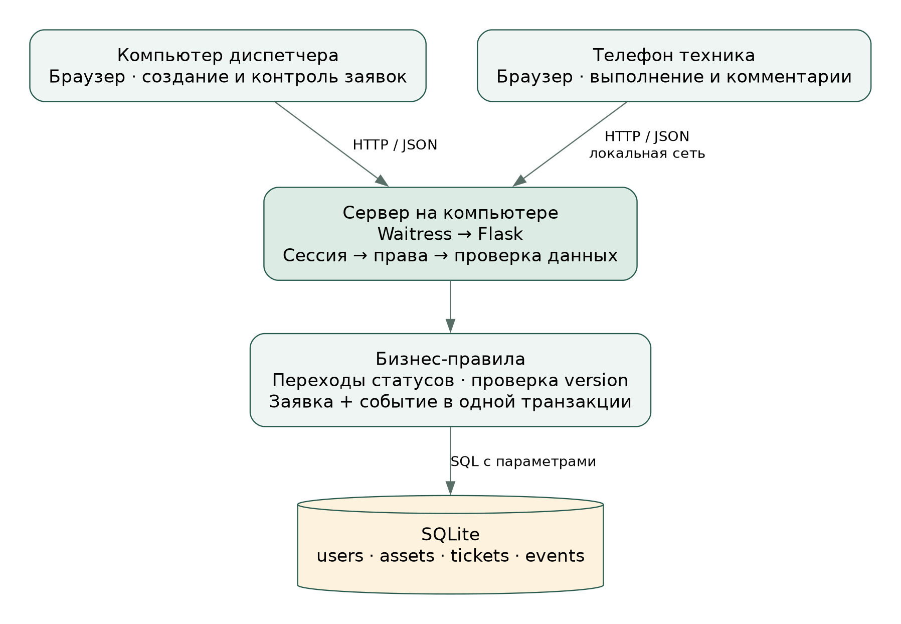
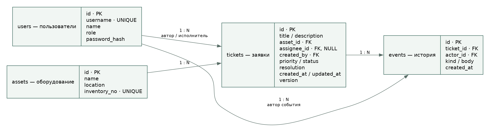

# Как заявка проходит через «Контур»

Приложение запускается на компьютере одним процессом Waitress. Браузер диспетчера и браузер техника получают HTML, CSS и JavaScript с этого сервера. Каждый хранит собственную cookie входа. Запросы к Flask передают данные в JSON. Только сервер открывает файл SQLite. Для перехода на другой компьютер достаточно изменить адрес сервера в браузере.

## Один запрос целиком

1. Диспетчер выбирает оборудование и техника. Браузер отправляет `POST /api/tickets` с заголовком `X-CSRF-Token`.
2. `protect_mutations` проверяет токен и, если он указан, заголовок `Origin`. Декоратор `require_user` читает роль пользователя. `create_ticket` проверяет поля, существование оборудования и роль исполнителя.
3. Сервер сохраняет заявку и начальное событие одной транзакцией. Версия равна 1. Сервер отвечает 201 с созданной карточкой.
4. Активный клиент техника периодически читает `/api/tickets`. Сервер ограничивает выборку условием по исполнителю. Браузер техника получает только его задачи.
5. При начале работы браузер отправляет `PATCH` со статусом `in_progress` и ожидаемой версией. `update_ticket` открывает `BEGIN IMMEDIATE`, проверяет права и допустимость перехода. Условный `UPDATE` ищет запись по `id` и `version`. После записи нового состояния и события сервер фиксирует транзакцию.
6. Если другой пользователь уже изменил заявку, сервер отвечает 409. Чтение истории и обновление карточки позволяют пользователю решить, повторять ли действие. Комментарий добавляется отдельной строкой и не меняет версию.

## Почему данные разделены

`assets` хранит описание оборудования, `users` — учётные записи. `tickets` отвечает на вопрос «кто работает и в каком состоянии заявка сейчас?». `events` отвечает на вопрос «как она пришла к этому состоянию?». Последняя таблица связывает запись истории с заявкой и автором. При новом цикле `tickets.resolution` очищается, но предыдущий результат остаётся в `events`.

Подробный [контракт API и ограничения](../BACKEND_NOTES.md), [функциональные проверки](VERIFICATION.md).
